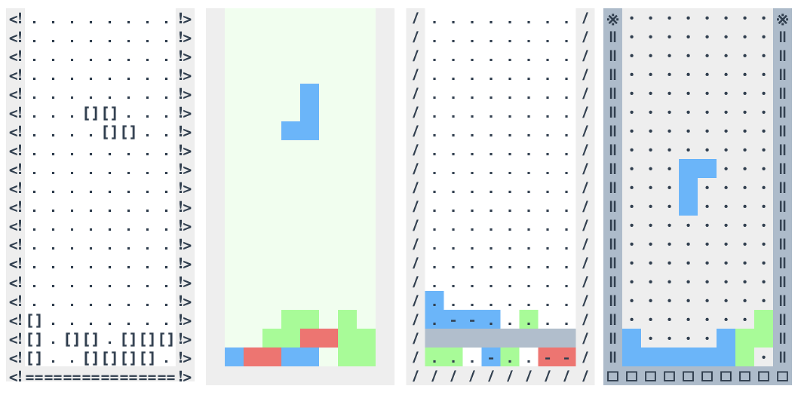

# JSTET

Browser puzzle game built with **Vue 3**, **Vuex 4**, and **Vite 7**.
The existing Vue Options API components and game engine are unchanged.



## Requirements

Node.js 20.19+ or 22.12+ (Vite 7 requirement), npm.

## Local development

```sh
npm install
npm run dev
```

Open http://localhost:1337/ . The legacy command `npm run serve` is also supported.

## Production build

```sh
npm run build
npm run preview
```

The static site is built in `dist/`. Relative asset paths are retained so it can be hosted from a subdirectory.
The existing `public/manifest.json` and PWA icons are copied as static assets.
The production build generates `service-worker.js` for offline caching, and the existing registration callbacks remain in place. The service worker requires HTTPS or localhost.

## Checks

```sh
npm run lint
npm run test:unit
```

The unit tests cover pure game utilities, the Vuex store, and the event bus. They do not replace an in-browser gameplay smoke test.

## Migration notes

* Vue 2.6 -> 2.7 was an intermediate step in PR #2. This branch migrates the app to Vue 3 without changing the Options API components.
* Global component auto-registration now uses `import.meta.glob` instead of webpack `require.context`.
* `vue.config.js` and Vue CLI dependencies have been removed.
* PWA generation uses `vite-plugin-pwa`. Registration remains in `src/registerServiceWorker.js`.
* Vue 3 uses `createApp` and Vuex 4, and a `mitt` event bus replaces Vue 2's removed `$on` API. The existing game mechanics and visual themes are retained.
