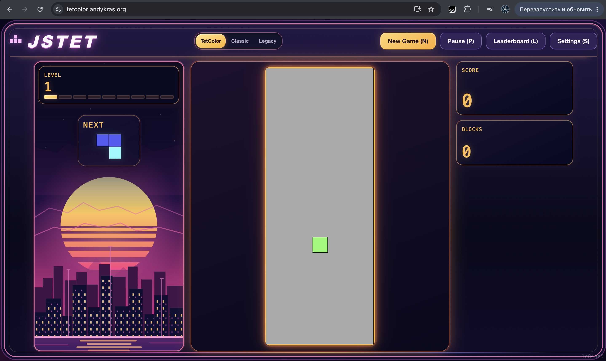

# JSTET — Arcade 2077



A browser puzzle game with two playable modes, built with **Vue 3 (Options API)**, **Vuex 4**, **Vite 7**, **Stylus**, and **mitt**.

The original **TetColor** game mechanics are preserved inside a modern arcade interface. **Classic** provides a separate seven-tetromino ruleset. A historical, independently implemented version remains accessible in **Developer Lab**.

## Play

Start the development server or open the deployed static site. A TetColor game starts automatically. Use the **TetColor / Classic** selector to change modes; switching mid-game requires confirmation and starts a new run.

- **TetColor**: connect three or more blocks of the same color horizontally, vertically, or diagonally; matching blocks disappear and can trigger cascades and bonuses. The default Arcade theme retains the original light-gray `#AAAAAA` well and six TetColor colors.
- **Classic**: stack the seven tetrominoes and clear complete horizontal lines to score points.
- **New Game** resets the well and counters. **Pause / Resume** freezes and resumes the current run. **Game Over** shows the final score and offers a restart.
- **Settings**: change **Arcade / Prism** appearance, opt into **Visual effects** (Off by default), reduced motion, keyboard-help visibility, and hard/soft Space-drop behavior immediately. The clearing-sequence option applies to the **next game**. Visual/control preferences, including the optional glass-block FX, are stored locally; an unfinished game is not saved.\n- **Audio**: enable or mute the mainframe hum and the keyboard, piece-lock and clearing effects in Settings. The hum pauses with the game, and browsers may require the first keyboard/touch interaction before allowing playback.

### Keyboard

| Key | Action |
| --- | --- |
| **← / →** | Move left / right; hold for repeat |
| **↑** | Rotate the falling piece |
| **↓** | Move down; hold for accelerated descent |
| **Space** | Drop using the selected soft/hard behavior |
| **S** | Toggle soft/hard drop behavior |
| **P** | Pause / resume |
| **Y** | Start a new game |

Editable controls and modal Settings/confirmation dialogs own keyboard input while focused. `N` and `F` debug shortcuts are not available in normal play.

### Touch

On phone and tablet widths, on-screen controls provide **left**, **right**, **rotate**, **down**, and **Drop**. Touch and hold directional buttons to repeat movement. Drop uses the same soft/hard setting as Space. The touch pad stays reachable while the game scrolls on small displays. The header provides New Game, Pause/Resume, mode choice and Settings.

### Developer Lab

Expand **Developer lab** in the footer and enable **Legacy engine** to inspect the original self-contained `src/components/stakan.vue` implementation. The main engine is stopped while the Lab is active, and restarts cleanly on return.

Lab controls include four historical skins: **Symbols** (1) and **ASCII** (2) show gray-blue `#aebece` blocks with dark glyphs. **Text** (3) displays the original `[ ]` symbols on a flat light well **without individual block backgrounds**; its dark Next Piece panel uses light glyphs for contrast. **Colors** (4) keeps the multicolored tetrominoes. The skin affects only rendering, not game rules or scoring. Choose a skin from the Developer Lab selector or press **1–4** on the keyboard; **A** toggles line-clear animation, and **S** toggles drop behavior. After entering Legacy, choosing a skin, toggling an option, or starting a new game, keyboard focus returns to the game field automatically—there is no need to click the well before moving pieces. These are Lab-only options, separate from the Arcade/Prism player themes.

Legacy's **Next Piece** preview displays a centered, compact 4×4 outline with
transparent empty cells. Its 20-row well scales with the available viewport
rather than creating a nested scrollable game panel; on very short screens the
page may scroll normally. The game rules and board dimensions are unchanged.

## Development

Requires **Node.js 20.19+ or 22.12+** and npm.

```sh
npm install
npm run dev           # Vite dev server on http://localhost:1337/
npm run test:unit     # node:test suite
npm run lint          # ESLint
npm run build         # Vite production bundle in dist/
npm run preview       # local production preview
```

The historical `npm run serve` alias also starts Vite.

## Leaderboard

The optional **Leaderboard** panel compares TetColor and Classic scores separately, with
weekly (Monday 00:00 UTC) and all-time views. **Only the game mode separates
leaderboards**: TetColor and Classic. Clearing, theme, controls and other
settings never split or exclude scores. Players can publish a completed game
under a nickname without registering;
joining explicitly opts in to publishing later eligible runs from the same browser.
After the first eligible Game Over, the nickname/publication panel opens automatically
and places the form above the rankings; no registration is needed on subsequent runs.
Games with a positive score qualify regardless of the clearing setting.
The player credential lives in localStorage, so clearing browser data loses the profile.
Users can disable automatic submissions or forget the local profile from the leaderboard.
Already published scores remain public when a device forgets its profile.

Personal best scores are also saved locally, independently of API availability and
separately by game mode, while retaining historical records from both clearing settings.

The Hall of Fame presents the top three players as a podium, followed by the remaining
Top 20. Each result uses compact SVG icon badges: golden Hard Drop,
turquoise phone/tablet, or blue desktop computer. Clearing mode is shown only
in the expanded run details, with blocks/lines, level and duration. Platform
is captured locally at Game Over based on browser device signals, so it is
informative but not proof of a player's physical hardware. Device and run
options **never** create ranking categories or disqualify results. Older
records without a stored device show a muted unknown-device icon (and a dash
in details), not an invented PC/phone badge. Your standing remains visible
outside the Top 20 with the same icon badges.

### Offline-first gameplay

The engine, controls, score calculation and personal-best tracking never wait for
the leaderboard API. The installed PWA uses its existing service-worker precache
for the game shell and assets, so after an initial online installation/load it
can be opened and played in airplane mode (subject to the browser keeping its
offline cache). New service workers do not silently replace an already-running
game: when a new version is detected, a **Reload** prompt appears after Game Over.
A current session is never forcibly refreshed. The small build ID at the bottom
of the game can be compared between devices to identify stale installed PWAs. API fetches are optional, fail immediately when the browser
reports offline and have bounded timeouts. No background connection is needed
to start or finish a game.

After a player joins the leaderboard, eligible completed scores are first saved
to an **opt-in local outbox** (up to 200 runs), then synchronized one at a time
on reconnect, page reopening or a manual sync request. Failed requests keep the
same run ID and retry without disturbing gameplay; the server already
deduplicates each run. The 10-second server spacing rule is respected during
batch synchronization. Offline scores include their original completion time,
so weekly standings use the week played, not the week uploaded. The outbox is
local to the browser and is cleared when the player explicitly forgets the
profile; uninstalling the PWA or clearing site storage may also remove it.

New players can always play offline and accumulate local personal bests; initial
nickname registration requires connectivity. The last successfully loaded
leaderboard is cached for optional, **clearly labeled stale viewing** while the
API is unavailable. Weekly snapshots are never shown for a different week.

The game remains fully playable without the API. The **current backend** is a
same-origin PHP leaderboard API served from `https://tetcolor.andykras.org`
(see `leaderboard-api/`), configured with
`VITE_LEADERBOARD_API_URL=https://tetcolor.andykras.org` at build time.
The Worker/D1 implementation in the repository is unused reference code. A feature
release must update both the static site and the API script together while preserving
existing player data and the rollback path.

### Visual-only preview (no backend)

For a specifically authorized non-master preview build, set
`VITE_LEADERBOARD_PREVIEW=1` at build time. The sample score list is visible **only**
when the page URL includes `?leaderboardPreview=1`; it is visibly labeled
"SAMPLE DATA", cannot publish scores and never writes to the leaderboard.
All other visitors see the normal disconnected state until the API is deployed.
Preview builds still run a production build, artifact checks, HTTPS checks and
atomic rollback safeguards. Default deployments run the full QA commands.

## Deployment and offline use

The site is a static build in `dist/`. Vite uses the relative base `./`, allowing deployment at a subdirectory path. `public/manifest.json` and icons are copied to the build, and `vite-plugin-pwa` generates `service-worker.js`; registration remains in `src/registerServiceWorker.js`. Service workers require HTTPS or localhost. Verify offline reload using the **production preview**, not only the development server.

### Production hosting

The production site is the static build served at `https://tetcolor.andykras.org`,
with the leaderboard API on the same origin. Releases are versioned and reversible;
server provisioning and credentials are deliberately not documented here.

## Implementation notes

- The primary engine lives in `src/utils/game.js` and `src/game/*`. It emits state through `mitt` into Vuex, while the UI renders the board, next piece and HUD.
- The shallow `Object.freeze` calls in `src/store.js` are intentional protection from deep reactive observation of the hot-path game board. They are **not** a request to rewrite the game engine.
- Touch input feeds the same engine command bus as keyboard input; the Lab has a separate engine and input lifecycle.
- Unit tests cover focused game, input and UI contracts. Browser gameplay, layout, performance and offline behavior require independent acceptance checks.
- The [Arcade 2077 roadmap](docs/plans/arcade-2077-ui-roadmap.md) and its stage handoffs record the design decisions, regressions and QA evidence.
