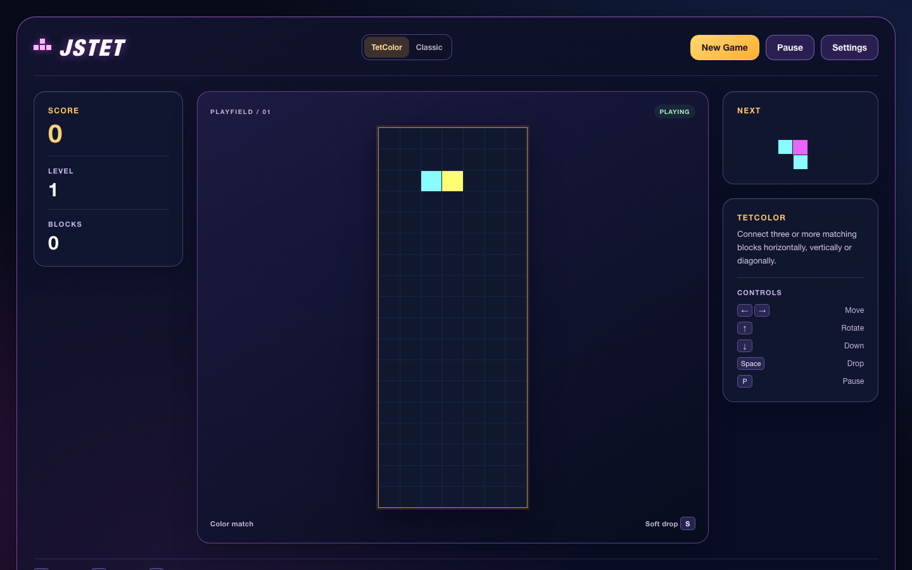
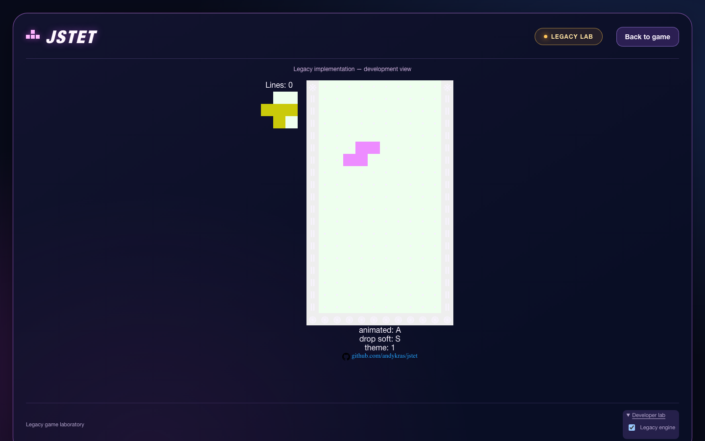
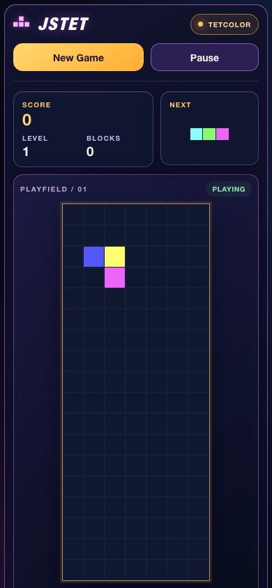
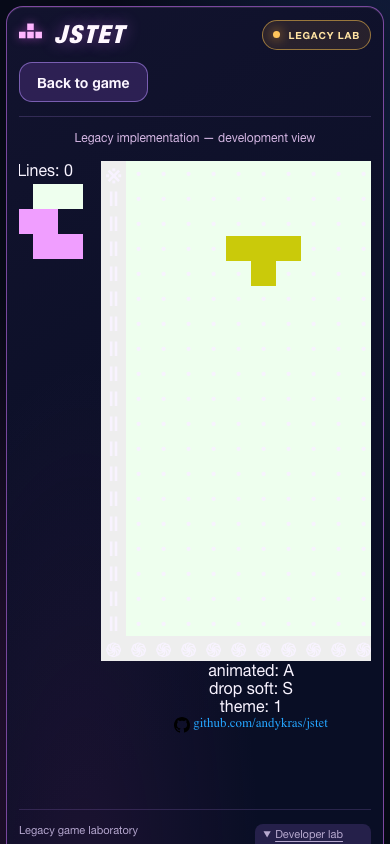

# Arcade 2077 — Stage 0 Baseline and QA Record

> Status: **COMPLETE - local runtime and browser QA recorded 2026-11-06; one pre-existing lint-config failure open, no gameplay changes**  
> Source snapshot: `master` at `fdb08065e34324b8bb5f0f2cb98f475f282baf8c` (2026-11-06)  
> QA branch: `feat/arcade-2077-ui` at `9bdbc5c` plus `docs/plans/baseline/screenshots/*.png` added in this commit
> QA environment: macOS, Node v22.23.2, npm 10.9.8, headless Google Chrome 156.0.8078.80 via CDP, clean `npm install`  
> Scope: document current behavior **before** changing the game shell, settings, or engine contracts.  
> Reference design: [Arcade Console](./arcade-2077-ui-reference.avif)  
> Roadmap: [Stage 0](./arcade-2077-ui-roadmap.md#stage-0--baseline-and-acceptance-harness)

## 1. What has actually been verified

| Check | Status | Evidence / limitations |
| --- | --- | --- |
| Repository structure and current sources | **PASS — static** | GitHub sources examined at the snapshot above |
| Existing test commands identified | **PASS — static** | `package.json`: `test:unit`, `lint`, `build`, `dev`, `preview` |
| Input event repeat contracts | **PASS — isolated** | Three `node:test` checks against a local copy of the unchanged `src/utils/events.js`: 3/3 passed |
| Full checkout `npm install` | **PASS** | Clean install 2026-11-06: up to date, 534 packages audited, 8 vulnerabilities (2 low, 4 moderate, 2 high) |
| Repository `npm run test:unit` | **PASS** | 7/7 `node:test` checks on this branch, 0 failures |
| Repository `npm run lint` | **FAIL - pre-existing config, exit 2** | ESLint 8.57.1 rejects the `vue/max-attributes-per-line` object options in `package.json` eslintConfig as an invalid schema; no source file is linted. Not fixed in Stage 0 (baseline only). |
| Repository `npm run build` | **PASS - exit 0** | Vite 7.3.7 build: `index.html`, CSS 4.77 kB, JS 104.44 kB, PWA `service-worker.js` + workbox precache generated |
| Vite dev and production preview | **PASS** | `npm run dev` serves on :1337 with no page console errors; `npm run preview` serves the production build on :4173, Service Worker registered and controlling after reload |
| Modern/naive desktop gameplay | **PASS with documented findings** | 1440x900 checks in section 6; B-01, B-02, B-03, B-05, B-07, B-08 reproduced in browser; B-04 verified by store/engine read; B-06 confirmed visible |
| Mobile viewport and touch/keyboard behavior | **PASS with findings** | 390x844 and 320x700 render with no horizontal overflow and no console errors; 844x390 landscape needs vertical scroll; no touch controls exist yet (expected, Stage 5) |
| PWA/offline behavior | **PASS with notes** | Manifest and both icons return 200; offline preview reload renders the board under Service Worker control; 4 offline resource errors logged for non-precached requests |

**Do not interpret static inspection or the isolated timing tests as a successful full build or playable browser session.** The command results and browser checks in section 6 are the Stage 0 evidence; the only failing command is the pre-existing lint-config schema error.

## 2. Existing runtime contract (source-confirmed)

### Main TetColor mode

- Entry: `src/App.vue` creates `Stakan(19, 9, 4)` and four TetColor piece types, connects `mitt` events, and starts `src/utils/game.js`.
- Board: 19 visible well rows plus 4 hidden rows; 9 columns including side walls. `0` = empty, `-1` = wall, `-2` = clearing marker.
- Rendering: `src/components/themes/tetcolor.vue` uses Vuex getters; score, level, cleared blocks, bonus and next-piece preview appear in the existing view.
- Match-3: `src/game/tetcolor.js` detects triples along horizontal, vertical and both diagonal axes, marks blocks, removes them by column and can trigger follow-up cascades.
- Standard line-clearing functions exist in `src/game/tetris.js`, but the Classic mode and its tetromino set are **not exposed as an actual selectable product mode** today.
- Gravity/level timing is driven by `requestAnimationFrame` and `performance.now()`. Input-repeat logic has independent timing.
- `Object.freeze` in Vuex is **shallow and intentional**; nested well cells remain mutable. It must not be removed as UI cleanup.

### Existing keyboard controls

| Key | Current main-game action | Legacy/naive action |
| --- | --- | --- |
| Left/Right | Move | Move |
| Up | Rotate | Rotate |
| Down | Accelerate downward movement | Move downward |
| Space | Soft/hard drop, as selected | Soft/hard drop, as selected |
| P | Toggle main game pause | Pause/restart timer |
| Y | New main-game run | No dedicated Y command |
| S | Toggle main hard-drop flag | Lowercase `s` on keyup toggles soft-drop behavior |
| N | Force next piece (developer control) | No dedicated N command |
| F | Toggle clearing mode (developer control) | No dedicated F command |
| A | No main-game binding | Lowercase `a` toggles line animation |
| 0–9 | No main-game binding | Switch legacy renderer theme on keyup |

**Clarification:** `S` selects how `Space` behaves in the main game; it is not the ordinary downward movement key. The exact in-browser behavior must be confirmed locally.

### Historical screenshots already in repository

- [TetColor](../../assets/screenshots/tetcolor.png)
- [Legacy theme variants](../../assets/screenshots/themes.png)
- [Simple renderer](../../assets/screenshots/simple-default.png)

These are **historical artifacts**, not verified screenshots of the current Vue 3/Vite build. Fresh desktop/mobile captures are still required.

## 3. Pre-existing issues and risks (not introduced by Arcade 2077)

These are findings from source inspection, **not claims that a bug was reproduced in a browser**. Assign fixes to the appropriate implementation stage.

| ID | Evidence in current code | Impact / planned owner |
| --- | --- | --- |
| B-01 | `App.vue` keeps its main keyboard listeners and engine loop while `<stakan>` mounts its own keyboard listeners/intervals when the naive checkbox is enabled | Two active input/loop owners; isolate and dispose in **Stage 1** |
| B-02 | `game.js` gates gravity and level advancement on `!game.paused`, but still evaluates left/right/rotate/down input when paused | Input may change the board during pause; correct run-state contract in **Stage 1** |
| B-03 | `App.vue` toggles `randomNoise` after each `createStakan()` call, alternating clean and partially randomized boards | Restart is not guaranteed to be an identical clean start; distinguish intentional Lab setup from player restart in **Stages 1/3** |
| B-04 | `game.js` has fixed runtime option fields; `game/options.js` is only loaded into Vuex for display | UI options are not authoritative; wire one source of truth in **Stage 1** |
| B-05 | `game.js` has module-local `$lines` and `$three` collections; `start()` does not explicitly clear them | Potential stale removal/cascade state on restart during clearing; regression test and correct lifecycle in **Stage 1** |
| B-06 | The main view presents a naive checkbox, unformatted options JSON and debug keys N/F | Replace player-facing shell and gate debug controls in **Stages 2/5** |
| B-07 | `game.js` emits `done`, but `App.vue` only logs it, with no modern game-over overlay | Give game-over a visible UI state in **Stage 4** |
| B-08 | `App.vue` has global keydown handlers without editable-focus gating; legacy `keydown` calls `preventDefault()` broadly | Keyboard interference with future settings dialogs; isolate in **Stages 1/5** |

Do not change gameplay in Stage 0 merely to silence these risks. When a finding is fixed, add a focused regression test and link the implementation commit.

Browser reproduction on 2026-11-06 (1440x900, headless Chrome 156, dev server): B-01 reproduced (modern engine keeps its item moving after the naive checkbox mounts, and Arrow keys move the modern item while naive is shown); B-02 reproduced (gravity holds while paused but ArrowRight moved the item from X=3 to X=4); B-03 reproduced (occupied-cell counts after consecutive New Game clicks alternated 6, 3, 5, 3, 5, 3); B-05 reproduced once (restart during pending clear state left score=45 and lines=2 on the fresh run instead of 0/0); B-07 reproduced (a full soak run reached started=false with score=18 and lines=3, with no visible game-over indication); B-08 reproduced (keydown from a focused text field still moved the piece and Space dropped it). B-04 verified by direct read (store options commit leaves game.maxLevel=9 and game.levelTime=60). B-06 confirmed (raw options JSON and naive checkbox render in the normal view). Full probe logs are summarized in section 6.

## 4. Repeatable local QA procedure

Run from a clean checkout on a machine with Node.js `^20.19.0 || >=22.12.0` and npm access. Do not add GitHub Actions.

```sh
git switch feat/arcade-2077-ui
git pull --ff-only
npm install
npm run test:unit
npm run lint
npm run build
npm run dev
```

Open `http://127.0.0.1:1337/`. Use a fresh browser profile or disable stale Service Workers when checking the development build.

Record for each command: **pass / fail / not run**, environment versions and any error log. Do not rewrite unrelated application code while collecting the baseline; report failures separately.

### Browser acceptance checks — modern TetColor

- [ ] The first page loads without console errors; board, next preview, level and score render.
- [ ] `Left` / `Right` move a piece; holding either key exhibits controlled repeat.
- [ ] `Up` rotates; `Down` accelerates downward movement; collisions keep pieces inside the well.
- [ ] `Space` performs the current drop behavior; `S` changes its mode; the selected mode is visibly reflected.
- [ ] `P` toggles pause; record whether movement/drop still work during pause (B-02).
- [ ] `Y` and New Game start new runs; record whether the initial well alternates with random noise (B-03).
- [ ] Score, cleared blocks and level update; check at least one matching triple and a successive clear/cascade.
- [ ] Game over terminates gameplay; record any missing visible indication (B-07).
- [ ] `N` and `F` behave as existing developer shortcuts (for later Lab migration).
- [ ] Switch naive mode while the modern game is active; document keyboard conflicts or simultaneous background activity (B-01).

### Browser acceptance checks — legacy / naive

- [ ] Legacy well and next preview render; movement, rotation and down/drop controls respond.
- [ ] Try number keys `1`, `3`, `4`: confirm renderer changes and note any overflow or stacking bugs.
- [ ] Try `a` (line animation) and `s` (drop mode), and verify `P` works.
- [ ] Observe a completed line, restart and game over if reproducible.
- [ ] Switching back to modern mode does not require a page reload; document any old timers/input still acting.

### Responsive and production checks

- [ ] Desktop **1440×900**: capture current modern and naive views.
- [ ] Phone portrait **390×844**: capture current modern and naive views (record overflow and usability issues even if broken).
- [ ] Narrow phone **320×700**: inspect horizontal clipping and control access.
- [ ] Short-height landscape **844×390**: inspect board visibility and scroll behavior.
- [ ] `npm run preview`: check the built UI, icons, `manifest.json`, Service Worker registration and offline reload.
- [ ] If hosted under a subdirectory, check that assets load with Vite `base: './'`.

Suggested screenshot output paths (tracked only once actually captured):

```text
docs/plans/baseline/screenshots/modern-desktop.png
docs/plans/baseline/screenshots/naive-desktop.png
docs/plans/baseline/screenshots/modern-mobile.png
docs/plans/baseline/screenshots/naive-mobile.png
```

Use browser devtools or Playwright viewport emulation; the device/viewport and commit must be recorded alongside the captures. Preserve failures as baseline evidence rather than fixing them silently.

## 5. Exit criteria and remaining handoff

**Stage 0 is not complete until** the full-checkout command results and browser/screenshot checks are recorded. Confirm which B-xx issues were reproduced, which remain only source-derived, and which checks could not be run.

When local QA is complete:
1. [x] Updated the checkboxes and result table in this file, embedding the screenshots from the paths above (see section 6).
2. [x] Set Stage 0 to **[x] Complete** in the roadmap: Gate 0 evidence is recorded. The only failing command is the pre-existing lint-config schema error, logged as an open tooling item.
3. [x] Committed the completed evidence to `feat/arcade-2077-ui` in the **same Draft PR** (this commit). The PR stays Draft.
4. Proceed to Stage 1 (game control and settings contract); do not open a second implementation PR.

## 6. Local QA evidence (2026-11-06, QA branch `feat/arcade-2077-ui`)

All checks below ran against `npm run dev` on `http://localhost:1337/` unless stated otherwise. No gameplay or config code was changed; probes read state through the store and the engine module only.

### 6.1 Command results

- `npm install`: PASS. `up to date, audited 534 packages`, 8 vulnerabilities (2 low, 4 moderate, 2 high).
- `npm run test:unit`: PASS. 7/7 `node:test` checks, 0 failures.
- `npm run lint`: FAIL (exit 2, pre-existing). ESLint 8.57.1 aborts during config validation: the `vue/max-attributes-per-line` object options in `package.json` eslintConfig do not match the installed `eslint-plugin-vue` schema. No source file is linted. Recorded, not fixed, in Stage 0.
- `npm run build`: PASS (exit 0). Outputs: `dist/index.html` 0.58 kB, `dist/assets/index-Cj-g1i59.css` 4.77 kB, `dist/assets/index-Cc_V96jB.js` 104.44 kB, plus generated `dist/service-worker.js` and workbox precache (3 entries).
- `npm run dev`: PASS. Served on :1337; first paint with no page console errors (only Vite connect messages and expected game logs).
- `npm run preview`: PASS. Served the production build on :4173; manifest and both icons returned 200; Service Worker registered, active, and controlling after reload; offline reload rendered the board (4 offline resource errors logged for non-precached requests).

### 6.2 Modern TetColor acceptance (desktop 1440x900)

- First paint: no console errors; board 183x458 with 126 cells; info shows Blocks, Level 1, Score, Bonus 0; next-piece preview renders.
- `Left` / `Right`: each press moves the store item one column (X 3 to 2, then 2 to 3).
- `Up`: rotates (R 0 to 1). `Down`: held key accelerates descent (Y fell 15 to 13 in one press window; a 600 ms hold moved Y 15 to 0 and locked the piece, spawning the next).
- Held `Left` for 700 ms: X moved 3 to 1 (multi-column repeat confirmed).
- `Space` in soft mode: `game.drop` rose to 1 and the piece fell faster, then locked. After `S` (label reads `hard drop`), `Space` locked instantly into a new piece. `S` toggles the label back and forth.
- `P`: pause flag set and gravity held the item stable over 1.5 s; however ArrowRight still moved the item (X 3 to 4) while paused. B-02 reproduced.
- New Game button and `Y`: both reset score, level, and lines to 0 with a fresh running item. Consecutive restarts alternated occupied-cell counts 6, 3, 5, 3, 5, 3. B-03 reproduced.
- Score/progress: a 120-drop soak run reached score=18, lines=3, then `started=false` (game over) with no visible game-over indication. B-07 reproduced.
- Restart-during-clear probe: one of two runs resumed with score=45 and lines=2 after pressing `Y` mid-clear. B-05 reproduced.
- `N` replaced the next piece; `F` toggled `singleBlock` true to false and back. Both debug keys work from normal play (B-06 context).
- Focus probe: with a text field focused, ArrowLeft moved the piece and Space dropped it. B-08 reproduced.
- Level timer: a fresh run advanced level 0 to 1 after 62 s with the game still running.
- Options probe: committing new options to the store left `game.maxLevel=9` and `game.levelTime=60`. B-04 verified (display only).
- Naive toggle while modern is active: the modern item kept descending (Y 15 to 14 to 12) and Arrow keys moved it while naive was shown. B-01 reproduced. Toggling back to modern needs no reload.

### 6.3 Legacy / naive acceptance (desktop 1440x900)

- Naive well and next preview render; `Left` / `Right` / `Up` / `Down` change the grid (6 to 8 cells differ per action); a 600 ms hold moves further (8 cells); `Space` drops (12 cells differ); `P` holds the grid stable over 1.2 s.
- Number keys `1`, `3`, `4` change the renderer theme; `a` toggles animation; `s` toggles drop mode; labels confirm (`animated: a`, `drop soft: s`, `theme: 4`).
- No console errors on the naive view.

### 6.4 Responsive and production checks

- Desktop 1440x900 modern and naive views captured (below). No horizontal overflow; no console errors.
- Phone portrait 390x844 modern and naive views captured (below). No horizontal overflow (`scrollWidth == innerWidth`); no console errors.
- Narrow phone 320x700: no horizontal clipping (modern 324/324, naive 367/367); no console errors.
- Short-height landscape 844x390: board visible with vertical scroll (modern page height 602, naive 707 vs viewport 390); no console errors.
- `npm run preview` production checks: see 6.1. Asset script path is relative (`./assets/...`), consistent with `base: './'`; subdirectory hosting was not exercised beyond the relative-path check.

### 6.5 Captured screenshots

Modern desktop (1440x900):



Naive desktop (1440x900):



Modern mobile (390x844):



Naive mobile (390x844):


